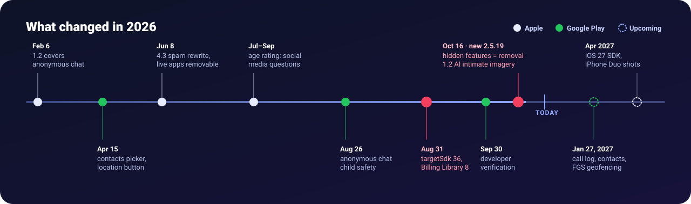
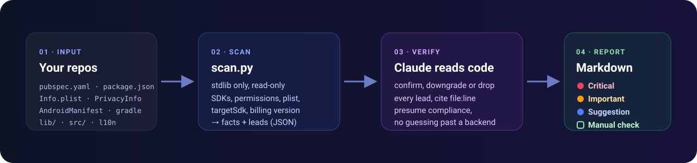

<p align="center">
  
</p>

<p align="center">
  <a href="LICENSE"></a>
  
  
  
</p>

**store-compliance** is a [Claude Code](https://claude.com/claude-code) skill that audits
mobile app repositories against the **Apple App Review Guidelines** and the **Google Play
Developer Policies**. Every problem it reports comes with the `file:line` that shows it,
the rule it breaks, what the store will do about it, and how to fix it.

2026 was a heavy year for store rules. Apple added **2.5.19** (hidden or dormant features
can get you removed from the Developer Program), extended **1.2** to AI-generated intimate
imagery and rewrote **4.3** spam. Google made **targetSdk 36** and **Play Billing Library 8**
hard gates for updates, and brought anonymous chat and third-party AI under existing
policies. A green build can still be a rejected or blocked release.

<p align="center">
  
</p>

## How it works

<p align="center">
  
</p>

1. **Scan.** `scripts/scan.py` (Python stdlib, read-only) collects facts: linked SDKs by
   category, Info.plist purpose strings, privacy manifest, Android permissions and
   foreground-service types, the resolved `targetSdk`, the Play Billing version inside your
   IAP plugin, remote-config gates, review-mode switches and more.
2. **Verify.** Claude reads the code behind each lead and confirms, downgrades or drops it.
   Compliance is presumed: a Critical or Important finding needs a cited line.
3. **Report.** One Markdown report per app, in your language, ordered by severity, plus a
   checklist for what lives only in App Store Connect and Play Console.

## Install

```bash
git clone https://github.com/motivexintelligence/store-compliance-skill.git ~/.claude/skills/store-compliance
```

That's it. Claude Code picks it up in the next session. To pin it to a single project
instead, clone it into `<project>/.claude/skills/store-compliance`.

Requirements: Python 3.8+. `gh` is only needed for scanning a GitHub repo you have not cloned.

## Use

Ask in your own words, or call it directly:

```text
/store-compliance                          # the app in the current directory
/store-compliance ~/code/my-app            # one repo (monorepos are fine)
/store-compliance acme/mobile-app          # a GitHub repo, shallow-cloned to a temp dir
/store-compliance ~/code all               # every mobile app under a folder
/store-compliance --lang tr                # report language override
```

```text
> Will this app pass App Store review after the October guideline update?
> We got a Guideline 5.1.1(v) rejection, what else is wrong before we resubmit?
> Scan all our Flutter repos for Play policy problems.
```

The scanner also runs on its own:

```bash
python3 -I scripts/scan.py ~/code/my-app --json /tmp/my-app.json   # facts + leads
python3 -I scripts/scan.py --find ~/code                           # list app dirs
```

## What the report looks like

```markdown
## 🔴 Critical

### 1. Feature switched off while in review · Apple 2.5.19
- **What:** `isReviewMode` hides the AI editor while the build is under review.
- **Evidence:** `lib/core/config/flags.dart:18`, `lib/features/editor/editor_page.dart:57`
- **Rule:** 2.5.19, new on 2026-10-16. Hidden or dormant features.
- **Risk:** Removal from the App Store and the Apple Developer Program.
- **Fix:** Delete the switch. Ship the editor on in the reviewed build and
  describe it in the App Review notes. Kill switches that only turn things off are fine.

### 2. Play Billing Library 7 · Play Billing deprecation
- **Evidence:** `pubspec.lock` → `purchases_flutter 8.10.1` (bundles PBL 7)
- **Risk:** Every update is rejected at upload since 2026-08-31.
- **Fix:** `purchases_flutter: ^9.0.0` or newer, then rebuild.
```

## What it checks

<table>
<tr><th>Area</th><th>Apple</th><th>Google Play</th></tr>
<tr><td><b>Bait and switch</b></td><td>2.5.19 review-mode switches, remote-config feature gates, hidden menus, 2.5.2 code push</td><td>Deceptive Behavior, Device and Network Abuse</td></tr>
<tr><td><b>AI</b></td><td>5.1.2(i) consent before sending data to third-party AI, 1.2 intimate-imagery safeguards</td><td>User Data (third-party AI), AI-Generated Content reporting</td></tr>
<tr><td><b>Accounts</b></td><td>5.1.1(v) in-app deletion, 4.8 Sign in with Apple, token revocation</td><td>In-app and web account deletion</td></tr>
<tr><td><b>Privacy</b></td><td>Purpose strings, ATT, privacy manifest, mic or camera sampled on a timer, App Privacy label inputs</td><td>Restricted permissions, Photo Picker, Contact Picker, Data safety inputs</td></tr>
<tr><td><b>Payments</b></td><td>3.1.1 IAP and restore, 3.1.2 subscription disclosure, external links</td><td>Play Billing, Billing Library 8, subscription disclosure</td></tr>
<tr><td><b>UGC and chat</b></td><td>1.2 filter, report, block, contact info, anonymous chat</td><td>UGC, Child Safety Standards, anonymous chat (2026-08-26)</td></tr>
<tr><td><b>Platform gates</b></td><td>Background modes, entitlements, export compliance, iOS 27 SDK (Apr 2027)</td><td>targetSdk 36, foreground-service types, exact alarms, SMS and call log</td></tr>
<tr><td><b>Quality</b></td><td>2.1 placeholders, 4.2 web wrappers, 1.3/5.1.4 kids</td><td>Minimum functionality, Families</td></tr>
</table>

The full rule set with verification steps and fixes lives in
[`references/apple.md`](references/apple.md) and [`references/google.md`](references/google.md).

## Keeping the rules fresh

Both stores change their rules several times a year. Each reference file carries a
`rules-as-of` date. When it is older than 45 days, the skill reads Apple Developer News
and the Play policy deadlines page first and lists anything newer in the report. It
does not edit the references silently. Pull requests that update them with a source
link are welcome.

## Limits

- It reads source, not the store consoles. Listing text, screenshots, age-rating answers,
  Data safety and App Privacy forms show up as manual checks.
- Plugins can add Android permissions through manifest merging. The scanner reads the
  merged release manifest when a build exists, otherwise it says so.
- It is a pre-submission review aid, not legal advice and not a guarantee of approval.
- For native Java/Kotlin apps, Google's own
  [`play-policy-insights`](https://github.com/android/skills/tree/main/play/play-policy-insights)
  skill goes deeper into Data safety tracing. This skill covers both stores and
  cross-platform stacks.

## Sources

- [App Review Guidelines](https://developer.apple.com/app-store/review/guidelines/) · [Apple Developer News](https://developer.apple.com/news/)
- [Play policy announcement, 15 July 2026](https://support.google.com/googleplay/android-developer/answer/17134731) · [Play policy deadlines](https://support.google.com/googleplay/android-developer/table/12921780)

## License

[MIT](LICENSE). Built by [MotiveX Intelligence](https://motivexintelligence.com).
Not affiliated with Apple or Google. App Store is a trademark of Apple Inc. Google Play
is a trademark of Google LLC.
