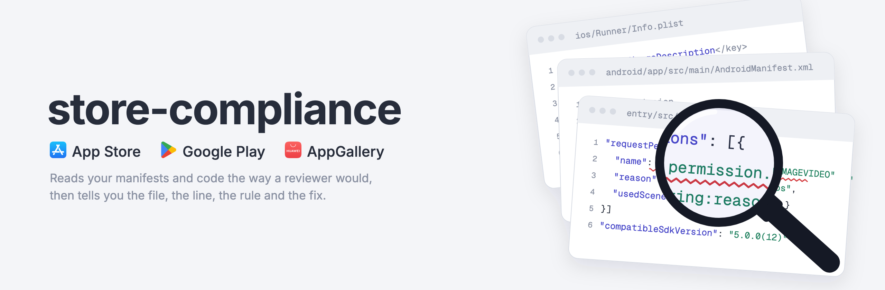
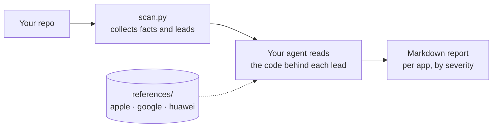

<p align="center">
  <picture>
    <source media="(prefers-color-scheme: dark)" srcset="assets/banner-dark.png">
    
  </picture>
</p>

<p align="center">
  <a href="https://github.com/motivexintelligence/store-compliance-skill/actions/workflows/ci.yml"></a>
  <a href="LICENSE"></a>
  
  <a href="https://agentskills.io"></a>
  
</p>

**store-compliance** is an [Agent Skill](https://agentskills.io) that audits mobile app
repositories against the **Apple App Review Guidelines**, the **Google Play Developer
Policies** and **Huawei AppGallery's review rules** for HarmonyOS and Android. Every problem
it reports comes with the `file:line` that shows it, the rule it breaks, what the store will
do about it, and how to fix it.

It works with any coding agent that reads `SKILL.md`: Claude Code, OpenAI Codex, Gemini CLI,
GitHub Copilot, Cursor, OpenCode, Amp, Goose, Cline, Kiro and more.

## Why

A green build can still be a rejected or blocked release. In 2026 alone:

- **Apple** made hidden or dormant features (**2.5.19**) grounds for developer account
  termination, brought AI-generated intimate imagery under **1.2**, replaced the age ratings
  with 4+/9+/13+/16+/18+, and requires the Declared Age Range API where state laws apply.
- **Google Play** made **targetSdk 36** and **Play Billing Library 8** hard gates for updates,
  brought third-party AI under the User Data policy, and has 16 KB page sizes, precise
  location declarations and zero-tap sign-in coming next.
- **Huawei AppGallery** ships HarmonyOS apps only in mainland China, so ICP filing, a HUAWEI ID
  login option and China's personal-information rules decide whether the app goes live.

## How it works



1. **Scan.** `scripts/scan.py` (Python standard library, read-only) collects facts: linked SDKs
   by category, Info.plist purpose strings and privacy manifests, Android permissions and the
   resolved `targetSdk`, the Play Billing version inside your IAP plugin, HarmonyOS
   `module.json5` permissions and build settings, remote-config gates, review-mode switches
   and more.
2. **Verify.** The agent reads the code behind each lead and confirms, downgrades or drops it.
   Compliance is presumed: a Critical or Important finding needs a cited line.
3. **Report.** One Markdown report per app, in your language, ordered by severity, plus a
   checklist for what lives only in App Store Connect, Play Console and AppGallery Connect.

## Install

With the cross-agent installer ([skills.sh](https://skills.sh)), for every agent on your machine:

```bash
npx skills add motivexintelligence/store-compliance-skill -g
```

With the GitHub CLI (2.90 or later):

```bash
gh skill install motivexintelligence/store-compliance-skill store-compliance --scope user
```

Or clone it by hand. The folder must be named `store-compliance`:

| Agent | User-level folder |
|---|---|
| Claude Code | `~/.claude/skills/store-compliance` |
| Codex, Gemini CLI, Copilot, Cursor, OpenCode, Amp, Goose, Roo, Devin | `~/.agents/skills/store-compliance` |
| Cline | `~/.cline/skills/store-compliance` |
| Kiro | `~/.kiro/skills/store-compliance` |

```bash
git clone https://github.com/motivexintelligence/store-compliance-skill.git ~/.agents/skills/store-compliance
```

For a single project, use the project-level folder instead (`.claude/skills/`, `.agents/skills/`,
`.github/skills/` and so on). Requirements: Python 3.8+. `gh` only for scanning a GitHub repo
you have not cloned.

## Use

Ask in your own words:

```text
> Will this app pass App Store review after the October guideline update?
> We got a Guideline 5.1.1(v) rejection. What else is wrong before we resubmit?
> Check our HarmonyOS build before we submit it to AppGallery.
> Scan all our Flutter repos for Play policy problems.
```

Or call it by name, where your agent supports that:

```text
/store-compliance                          # the app in the current directory
/store-compliance ~/code/my-app            # one repo (monorepos are fine)
/store-compliance acme/mobile-app          # a GitHub repo, shallow-cloned to a temp dir
/store-compliance ~/code all               # every mobile app under a folder
/store-compliance --lang tr                # report language override
```

The scanner also runs on its own, without an agent:

```bash
python3 -I scripts/scan.py ~/code/my-app --json my-app.json   # facts and leads
python3 -I scripts/scan.py --find ~/code                     # list app folders
```

## What the report looks like

```markdown
## 🔴 Critical

### 1. Feature switched off while in review · Apple 2.5.19
- **What:** `isReviewMode` hides the AI editor while the build is under review.
- **Evidence:** `lib/core/config/flags.dart:18`, `lib/features/editor/editor_page.dart:57`
- **Rule:** 2.5.19 (2026-10-16). Hidden, dormant or undocumented features.
- **Risk:** Removal from the App Store and termination of the developer account.
- **Fix:** Delete the switch. Ship the editor on in the reviewed build and describe it
  in the App Review notes. Kill switches that only turn things off are fine.

### 2. WeChat login without HUAWEI ID · AppGallery 3.16
- **Evidence:** `ohos/oh-package.json5` → `@tencent/wechat_open_sdk`, no `@kit.AccountKit`
- **Risk:** Rejected in AppGallery review.
- **Fix:** Add `LoginWithHuaweiIDButton` next to the other social logins and the
  `client_id` entry in `module.json5` metadata.

## 🟡 Important

### 3. Native code with Android Gradle Plugin 8.3 · Play 16 KB page size
- **Evidence:** `android/settings.gradle:3`
- **Risk:** From 2027-02-01 Play will not release updates without 16 KB alignment.
- **Fix:** AGP 8.5.1+ and NDK r28+, then check the bundle in App bundle explorer.
```

## What it checks

<table>
<tr><th>Area</th><th>Apple</th><th>Google Play</th><th>Huawei AppGallery</th></tr>
<tr><td><b>Bait and switch</b></td><td>2.5.19 review-mode switches, remote-config gates, hidden menus, 2.5.2 code push</td><td>Deceptive Behavior, Device and Network Abuse</td><td>3.13 self-update and hot fixes</td></tr>
<tr><td><b>AI</b></td><td>5.1.2(i) consent before third-party AI, 1.2 intimate-imagery safeguards</td><td>User Data (third-party AI), AI-Generated Content</td><td>AI feature declaration and labels</td></tr>
<tr><td><b>Accounts</b></td><td>5.1.1(v) deletion, 4.8 Sign in with Apple, token revocation, relay domain</td><td>In-app and web deletion, zero-tap sign-in</td><td>3.16 HUAWEI ID, deletion within 15 working days</td></tr>
<tr><td><b>Privacy</b></td><td>Purpose strings, ATT, privacy manifests, SDK signatures, App Privacy inputs</td><td>Restricted permissions, Photo and Contact Pickers, precise location, Data safety inputs</td><td><code>module.json5</code> reasons, restricted (ACL) permissions, consent before SDK init, the two lists, OAID</td></tr>
<tr><td><b>Payments</b></td><td>3.1.1 IAP and restore, 3.1.2 subscriptions, storefront-gated link-outs, loot-box odds</td><td>Play Billing 8 and 9, subscription disclosure</td><td>Auto-renewal rules, probabilities</td></tr>
<tr><td><b>UGC and age</b></td><td>1.2 report and block, anonymous chat, Declared Age Range, age-rating inputs</td><td>UGC, Child Safety Standards, Age Signals</td><td>4.15 report wording, minors (Section 8)</td></tr>
<tr><td><b>Platform gates</b></td><td>Xcode 26 and iOS 13 floors, ads in extensions, VPN, export compliance</td><td>targetSdk by form factor, 16 KB pages, Android 16 behaviour, R8, VPN</td><td>Build gates (bundleName, debug, SDK levels, signing, device types), GMS dependency, ICP filing</td></tr>
</table>

The full rule set with verification steps and fixes lives in
[`references/apple.md`](references/apple.md), [`references/google.md`](references/google.md)
and [`references/huawei.md`](references/huawei.md).

## Deadlines it knows about

| Date | Store | Change |
|---|---|---|
| 2026-11-16 → 2027-01-12 | Apple | Shared Location and Dating questions in the age rating, dating is 18+ |
| 2026-12-01 | Google Play | Japan payment authorization |
| 2027-01-01 | AppGallery | Upgrade prompts for HarmonyOS target SDK below API 26 |
| 2027-01-27 | Google Play | Precise location declaration, Contact Picker, call-log verification ends, geofencing FGS ends |
| 2027-02-01 | Google Play | 16 KB page size hard block, trader status |
| early 2027 | Apple | Regulated medical device declaration for health apps (EU, UK, US) |
| April 2027 | Apple | iOS 27 SDK and iPhone Duo screenshots |
| April 2027 | Google Play | Zero-tap sign-in (Restore Credentials) |
| 2027-08-31 | Google Play | Play Billing Library 9 |

## Supported stacks

| Stack | iOS | Android | HarmonyOS |
|---|---|---|---|
| Flutter | ✓ | ✓ | ✓ Flutter for OpenHarmony (`ohos/`) |
| React Native | ✓ | ✓ | ✓ React Native for OpenHarmony (`harmony/`) |
| Expo (managed and prebuild) | ✓ | ✓ | |
| Native (Swift, Kotlin, Java) | ✓ | ✓ | |
| ArkTS | | | ✓ |
| uni-app | | | ✓ (`harmony-configs/`) |

Monorepos are fine: the scanner finds every app folder inside the repo.

## Keeping the rules fresh

The stores change their rules several times a year. Each reference file carries a
`rules-as-of` date. When it is older than 45 days, the skill first reads Apple Developer
News, the Play policy deadlines page and the AppGallery review guidelines, and lists anything
newer in the report. It does not edit the references silently. Pull requests that update
them with a source link are welcome, see [CONTRIBUTING.md](CONTRIBUTING.md).

## Limits

- It reads source, not the store consoles. Listing text, screenshots, age-rating answers,
  Data safety, App Privacy, the AppGallery privacy statement and ICP filing show up as
  manual checks.
- Plugins can add Android permissions through manifest merging. The scanner reads the merged
  release manifest when a build exists, otherwise it says so.
- Taro keeps its HarmonyOS project outside the repo, so it cannot be scanned from there.
- It is a pre-submission review aid, not legal advice and not a guarantee of approval.
- For native Java/Kotlin apps, Google's
  [`play-policy-insights`](https://github.com/android/skills/tree/main/play/play-policy-insights)
  skill goes deeper into Data safety tracing.

## Contributing

Rule updates, new checks and false-positive reports are all welcome. Read
[CONTRIBUTING.md](CONTRIBUTING.md) first. Report security issues as described in
[SECURITY.md](SECURITY.md). This project follows a [Code of Conduct](CODE_OF_CONDUCT.md).

## Sources

- Apple: [App Review Guidelines](https://developer.apple.com/app-store/review/guidelines/) · [Developer News](https://developer.apple.com/news/) · [Upcoming requirements](https://developer.apple.com/news/upcoming-requirements/)
- Google Play: [Policy announcements](https://support.google.com/googleplay/android-developer/announcements/13412212) · [Policy deadlines](https://support.google.com/googleplay/android-developer/table/12921780)
- Huawei: [应用审核指南](https://developer.huawei.com/consumer/cn/doc/app/50104) · [AppGallery Review Guidelines](https://developer.huawei.com/consumer/en/doc/app/50104)

## License

[MIT](LICENSE). Built by [MotiveX Intelligence](https://motivexintelligence.com).

Not affiliated with Apple, Google or Huawei. App Store is a trademark of Apple Inc., Google
Play of Google LLC, AppGallery and HarmonyOS of Huawei Technologies Co., Ltd.
